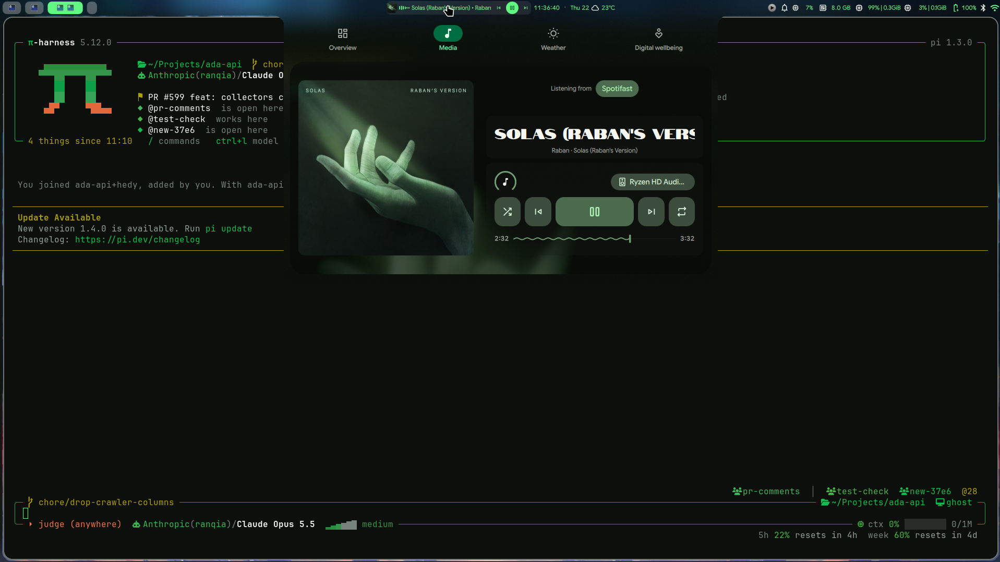
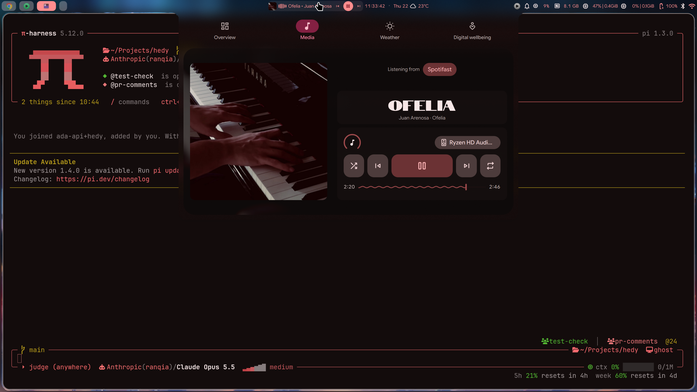

# Music Theme

A [Dux Shell (DMS)](https://github.com/duxlabs-dev/dux-shell) plugin that themes your system from the album art of the track that is playing. The shell, GTK and Qt apps, terminals and editors follow the cover, and your wallpaper stays as it is.

<div align="center">
  
  
</div>

## Features

- Seeds the Dynamic theme with the color DMS takes from the album art, the same accent the media player widget uses
- Runs through DMS's own matugen pipeline, so every template DMS renders (GTK, Qt, terminals, Neovim, VS Code, Firefox, Zen) follows the track with your contrast, spec and template settings
- Gives black and white covers a neutral theme instead of a strong color with an arbitrary hue
- Keeps the album colors through track changes and through pauses shorter than the hold time. DMS gets the theme back after the hold time, when the player closes, or when you turn the plugin off
- Puts the album colors back when DMS regenerates the theme mid-track, for example after a wallpaper change, a light/dark toggle or a scheme change
- The settings page shows the track, what the plugin is doing and a preview of each palette built from the current cover. When a DMS setting blocks the plugin, a button there fixes it
- Reads MPRIS and album art through DMS, without `playerctl` or Python
- Has a Portuguese (Brazil) translation

## Requirements

- DMS 2.0.0 or newer with matugen enabled, which it is unless `DMS_DISABLE_MATUGEN=1` is set
- The Dynamic theme selected in DMS
- "Use album art accent" turned on in the media player options (on by default)
- The Dynamic theme's derived color left on the wallpaper, not a custom color
- A media player exposing MPRIS with album art (Spotify, browsers, mpv, etc.)

The plugin stays idle until all of these hold. Its settings page says which one is missing and offers a button to fix it.

For DMS 1.x, use the [2.0.0 release](https://github.com/felipeadeildo/dms-music-theme/releases/tag/v2.0.0).

## Installation

```bash
git clone https://github.com/felipeadeildo/dms-music-theme.git \
  ~/.config/dms/plugins/MusicTheme
```

1. Open DMS Settings (Ctrl+,)
2. Go to Plugins
3. Click "Scan for Plugins"
4. Turn on "Music Theme"

## Configuration

- **Palette** picks the matugen scheme that turns the cover color into a full palette. System follows the scheme set in DMS. Each option previews the palette it would build from the cover that is playing.
- **When playback stops** sets how long the album colors stay after a pause before DMS takes the theme back: right away, after 10 seconds to 5 minutes, or only when the player closes.
- **Update delay** sets how long the album art color has to settle before the theme changes.

## License

MIT
